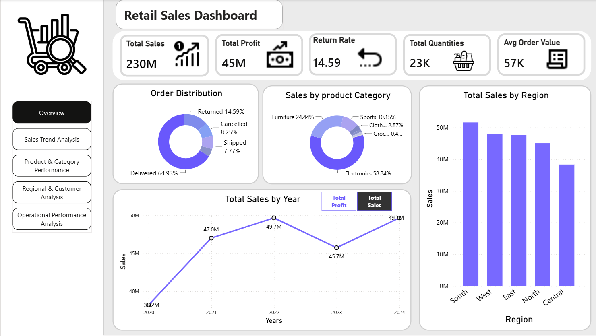

# Retail Sales Analytics & Return Prediction

An end-to-end retail analytics project that turns transaction data into business insights with **MySQL**, an interactive **Power BI** dashboard, and a **Python/XGBoost** return-prediction experiment.

> **At a glance:** 4,120 cleaned records · 21 fields · 2020–2024 · 14.59% observed return rate

## Explore this project

- [Project overview](#project-overview)
- [Dashboard gallery](#dashboard-gallery)
- [Key findings](#key-findings)
- [Analytics workflow](#analytics-workflow)
- [Project files](#project-files)
- [Run the project](#run-the-project)
- [Model results and limitations](#model-results-and-limitations)

## Project overview

The project follows a typical analytics workflow: inspect and clean retail transactions, explore business questions in SQL, present findings in Power BI, and test whether order attributes can help identify returned orders.

The repository includes both the raw and cleaned datasets, the SQL analysis script, a Jupyter notebook, the Power BI report, and exported screenshots of its report pages.

| Dataset measure | Value |
|---|---:|
| Raw transactions | 4,310 |
| Cleaned transactions | 4,120 |
| Fields | 21 |
| Date range | 2020-01-01 to 2024-12-30 |
| Sales amount (cleaned data) | 230.30 million |
| Profit (cleaned data) | 44.85 million |
| Returned transactions | 601 (14.59%) |
| Units sold | 22,618 |

Amounts are shown in the dataset's units; the files do not specify a currency.

## Dashboard gallery

Open the [Power BI report](Dashboard/retail_sales_analysis.pbix) in Power BI Desktop to explore the report. The screenshots below link to their full-size versions.

### Overview

KPI cards, order-status mix, category and regional sales, and yearly sales/profit.

[](Images/Overview.png)

### Sales Trend Analysis

Monthly sales, order counts, and monthly sales growth, with a year slicer.

[](Images/Sales%20Trend%20Analysis.png)

### Product & Category Performance

Product sales, category profit, and product return rates.

[](Images/Product%20%26%20Category%20Performance.png)

### Regional & Customer Analysis

Regional and city performance, age-group profit, gender distribution, and customer ratings, with a region slicer.

[](Images/Regional%20%26%20Customer%20Analysis.png)

### Operational Performance Analysis

Payment methods, customer satisfaction, and returned-order counts by shipping-time group, with a rating slicer.

[](Images/Operational%20Performance%20Analysis.png)

## Key findings

These summary figures are calculated from the checked-in cleaned CSV; the dashboard rounds KPI values for display.

- **Electronics** is the largest sales category at approximately **135.51 million (58.8%)**, followed by **Furniture** at **56.29 million (24.4%)**.
- The cleaned data contains **601 returned transactions out of 4,120**, a return rate of **14.59%**.
- The dashboard's overview shows **South** leading the displayed regional sales comparison.
- The product performance page highlights **Tablet** as its highest-sales product.
- The yearly sales view shows an overall rise from 2020 to 2024, with a dip in 2023.

## Analytics workflow

```text
Raw_retail_sales_dataset.csv
              |
              v
      SQL cleaning & EDA
              |
              v
     retail_Sales_data_clean.csv
          /             \
         v               v
   Power BI report   Python return model
```

### SQL: cleaning and exploratory analysis

The [SQL script](retail_sales_Analysis_using%20_SQL/retail_sales.sql) is written for MySQL. It defines a transaction table, checks and removes empty/duplicate rows, handles selected missing and suspicious values, converts column types, and contains analysis queries for sales, profit, returns, products, regions, customers, and shipping operations.

### Power BI: interactive reporting

The [Power BI report](Dashboard/retail_sales_analysis.pbix) is organized into five pages: Overview, Sales Trend Analysis, Product & Category Performance, Regional & Customer Analysis, and Operational Performance Analysis. The report includes KPI cards, charts, page navigation, and slicers such as year, region, and rating.

### Python: return prediction

The [Jupyter notebook](predicting_returns_using_python/retail_sales_analysis.ipynb) loads the cleaned CSV, reviews data quality and distributions, one-hot encodes categorical inputs, and trains an XGBoost classifier. Its features include age, quantity, unit price, discount, shipping cost, shipping duration, customer satisfaction, gender, region, category, and payment method.

## Project files

| File or folder | Purpose |
|---|---|
| [`Dataset/Raw_retail_sales_dataset.csv`](Dataset/Raw_retail_sales_dataset.csv) | Raw transaction data (4,310 rows, 21 columns) |
| [`Dataset/retail_Sales_data_clean.csv`](Dataset/retail_Sales_data_clean.csv) | Cleaned data used for analysis (4,120 rows, 21 columns) |
| [`retail_sales_Analysis_using _SQL/retail_sales.sql`](retail_sales_Analysis_using%20_SQL/retail_sales.sql) | MySQL table definition, cleaning steps, and EDA queries |
| [`Dashboard/retail_sales_analysis.pbix`](Dashboard/retail_sales_analysis.pbix) | Power BI report |
| [`predicting_returns_using_python/retail_sales_analysis.ipynb`](predicting_returns_using_python/retail_sales_analysis.ipynb) | EDA, model training, and evaluation notebook |
| [`Images/`](Images/) | Exported dashboard page previews |

## Run the project

### 1. Explore the dashboard

Install/open [Power BI Desktop](https://www.microsoft.com/power-platform/products/power-bi/desktop) and open `Dashboard/retail_sales_analysis.pbix`. If Power BI prompts for a data source, point it to the cleaned CSV in `Dataset/`.

### 2. Run the notebook

Install Python and Jupyter, then install the notebook dependencies:

```bash
pip install pandas numpy matplotlib seaborn scikit-learn xgboost jupyter
```

Open `predicting_returns_using_python/retail_sales_analysis.ipynb`. The data-loading cell currently points to a local `C:\Users\Lenovo\Downloads\...` path; update it to the location of this repository's cleaned CSV. For example, when the notebook's working directory is `predicting_returns_using_python`:

```python
df = pd.read_csv("../Dataset/retail_Sales_data_clean.csv")
```

Run the cells in order to reproduce the notebook's exploration, training, and evaluation.

### 3. Run the SQL analysis

Use MySQL Workbench or a compatible MySQL client. Load the raw CSV into the `retail_sales_analysis` table using the script's column layout, then run the cleaning and EDA sections in order. The cleaned CSV is already included if you want to explore the dashboard or notebook without running the cleaning script.

> **Setup note:** The SQL file currently creates a database named `rataildb` but then selects `retaildb`. Make those database names consistent before running the script from a fresh MySQL setup.

## Model results and limitations

The notebook uses a stratified 80/20 train-test split (`random_state=42`). Its saved evaluation output reports **85% accuracy**, but the returned-order class has only **4% recall** (5 of 120 returned test records identified; 115 missed). The model therefore mostly recognizes non-returned orders and is **not reliable for return intervention or production use** in its current form. Accuracy alone is misleading for this imbalanced target.

The SQL and cleaned data also retain lowercase variants of some `order_status` values (for example, `Delivered` and `delivered`), which can appear as separate groups in case-sensitive analysis. Normalize these labels before comparing status counts.

## Skills demonstrated

SQL data preparation and analysis · Data quality checks · Exploratory data analysis · Power BI dashboard design · Data visualization · Feature engineering · Classification evaluation · Business storytelling

---

**Author:** Abhi · Aspiring Data Analyst | SQL | Power BI | Python | Machine Learning
